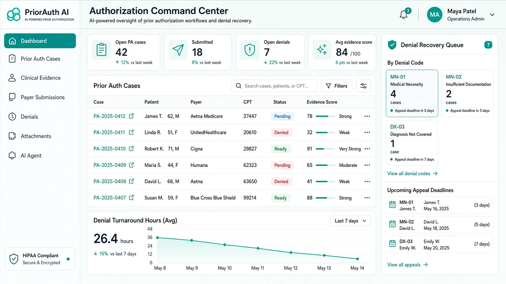

# AI Prior Authorization Agent (Healthcare)



**SEO description:** AI prior authorization healthcare agent that gathers clinical evidence, submits payer requests, tracks status, and reduces denial turnaround time.

**Tagline:** Cut days off authorization and denial cycles  
**Industry:** Healthcare / Revenue Cycle  
**Accent:** `#0E7490`  
**Author:** [Imran Ahmed](https://imrandev.bd) (`me@imrandev.bd`)

---

## Why health systems choose this stack

Prior auth desks still burn hours hunting chart evidence, re-keying payer portals, chasing status, and rebuilding appeal packets after denials. **AI Prior Authorization Agent** is a complete Laravel + Filament business platform that puts an AI co-pilot beside utilization management and RCM teams — gathering clinical evidence, submitting payer requests, tracking status workflows, managing attachments, and shrinking denial turnaround — with **every module toggleable**.

### RCM time-saver ROI

| Manual PA / denial work | Typical weekly hours | With PriorAuth AI |
|---|---|---|
| Chart digging for medical necessity | 10–18 hrs | AI evidence gather + relevance scoring |
| Portal re-key / fax packet assembly | 8–14 hrs | Structured submissions + attachment packets |
| Status call-backs & spreadsheet tracking | 5–9 hrs | Status workflow timeline + workqueue |
| Denial triage & appeal deadline tracking | 6–12 hrs | Denial codes, deadlines, turnaround KPIs |
| Incomplete packet resubmits | 3–6 hrs | Evidence score gates before submit |

A mid-size RCM desk often recovers **15–30 specialist hours per week**. At fully-loaded UM/auth staffing cost, that is frequently **$3,000–$8,000+/month** in recovered capacity — before counting faster approvals and fewer abandoned scheduled procedures.

---

## Features

- **AI Prior Auth Agent** — evidence gather, packet draft, appeal assist, and status-check runs with recommendations
- **Prior Auth Requests** — CPT/HCPCS/ICD cases, urgency, due dates, evidence scores, assignee workqueues
- **Clinical Evidence** — EHR-sourced notes, imaging, guidelines, AI extraction flags, relevance scoring
- **Payer Directory** — commercial / MA / Medicaid profiles, portal hints, API preference flags
- **Payer Submissions** — portal, fax, EDI, API channels with confirmation references
- **Denial Tracking** — denial codes, appeal deadlines, overturn outcomes, turnaround hours
- **Status Workflows** — immutable timeline events across the authorization lifecycle
- **Attachments** — LMNs, imaging PDFs, clinical docs toggled into the submission packet
- **Module Control Plane** — enable/disable domains from config + Filament Modules resource
- **Multi-role users** — Super Admin, Admin, Manager, Staff, Client, Demo
- **Public marketing pages** — home, features, modules, pricing, demo
- **Dockerized** — `Dockerfile`, `docker-compose.yml`, nginx, MySQL, Redis
- **Packagist toolkit** — `imrandevbd/*` packages for AI hub, catalog, PDF, slug, speed, admin, attendance

---

## Modules (on/off)

| Module key | Default | Purpose |
|---|---|---|
| `patients` | ON | Member demographics & coordinators |
| `payers` | ON | Payer directory & portal prefs |
| `prior_auth` | ON | Authorization cases & workqueue |
| `clinical_evidence` | ON | Evidence gather & scoring |
| `payer_submissions` | ON | Portal/API/fax/EDI submissions |
| `denial_tracking` | ON | Denial & appeal recovery |
| `status_workflows` | ON | Status timeline events |
| `attachments` | ON | Packet documents |
| `ai_agent` | ON | AI prior-auth agent runs |
| `attendance` | OFF | Optional staff time-clock hub |

Filament navigation hides disabled modules. Services refuse work when their module is off.

---

## Tech stack

- PHP 8.3+ / Laravel 13
- Filament 4 admin (`/admin`) — primary color `#0E7490`
- Livewire 3
- SQLite (local default) or MySQL (Docker)
- Packages:
  - `imrandevbd/drutogoti`
  - `imrandevbd/laravel-admin-panel`
  - `imrandevbd/laravel-ai-catalog`
  - `imrandevbd/laravel-ai-hub`
  - `imrandevbd/laravel-attendance-hub`
  - `imrandevbd/laravel-unicode-pdf`
  - `imrandevbd/laravel-universal-slug`

> **Note:** Upstream Packagist builds of `drutogoti`, `laravel-admin-panel`, and `laravel-attendance-hub` currently constrain `illuminate/*` to Laravel 11/12. This repo vendors Laravel 13–compatible path shims under `packages/` so Composer resolves cleanly while keeping the same package names. Real Packagist installs: `laravel-ai-hub`, `laravel-ai-catalog`, `laravel-unicode-pdf`, `laravel-universal-slug`.

---

## Quick start

```bash
composer install
cp .env.example .env
php artisan key:generate
touch database/database.sqlite
php artisan migrate --seed
php artisan serve
```

- Marketing site: `http://127.0.0.1:8000`
- Filament admin: `http://127.0.0.1:8000/admin`

### Demo users (password: `password`)

| Role | Email |
|---|---|
| Demo | `demo@priorauth-ai.test` |
| Super Admin | `superadmin@priorauth-ai.test` |
| Admin | `admin@priorauth-ai.test` |
| Manager | `manager@priorauth-ai.test` |
| Staff | `staff@priorauth-ai.test` |
| Client | `client@priorauth-ai.test` |

---

## Docker

```bash
docker compose up --build -d
```

Nginx serves on port **8080**, MySQL on **3307**, Redis on **6380**.

---

## Opportunities for health systems & RCM vendors

- White-label for specialty groups (ortho, oncology, infusion, imaging)
- Embed into Epic/Cerner adjacent RCM workflows via API submission adapters
- Sell denial-recovery SLAs with turnaround dashboards for payer negotiations
- Extend AI hub prompts per payer medical policy library

---

## 🤝 Let's Connect & Collaborate

I am open to Senior Remote Full-Stack Roles, AI Platform Architecture Contracts, and Enterprise Technical Advisory.

Timezone: UTC+6 (Dhaka / Rangpur, Bangladesh) — Flexible overlap with US, UK, and European business hours.

Delivery Mode: Async-ready, Slack, Discord, Jira, GitHub, and production-first accountability.

| Channel | Address / Handle | Quick Action |
|---|---|---|
| 🌐 Primary Portfolio | [imrandev.bd](https://imrandev.bd) | [Visit Site ↗](https://imrandev.bd) |
| 📦 Packagist Packages | [packagist.org/packages/imrandevbd/](https://packagist.org/packages/imrandevbd/) | [View Packages ↗](https://packagist.org/packages/imrandevbd/) |
| 💼 LinkedIn Profile | [linkedin.com/in/imranbru99](https://linkedin.com/in/imranbru99) | [Connect ↗](https://linkedin.com/in/imranbru99) |
| 🐙 GitHub Profile | [github.com/imranbru99](https://github.com/imranbru99) | [Follow ↗](https://github.com/imranbru99) |
| 💬 WhatsApp Direct | +880 1576-918420 | [Chat Now ↗](https://wa.me/8801576918420) |
| 📧 Direct Email | me@imrandev.bd | [Send Email ↗](mailto:me@imrandev.bd) |
| 🐦 X (Twitter) | [@imrandev_bd](https://x.com/imrandev_bd) | [Follow ↗](https://x.com/imrandev_bd) |
| 📺 YouTube Tech | [@ImranDevBD](https://youtube.com/@ImranDevBD) | [Subscribe ↗](https://youtube.com/@ImranDevBD) |
